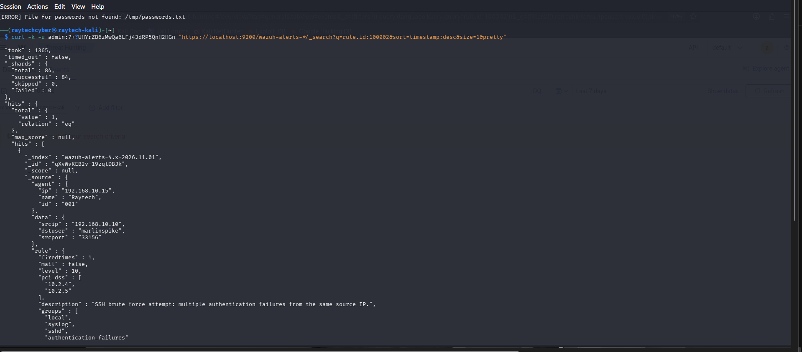
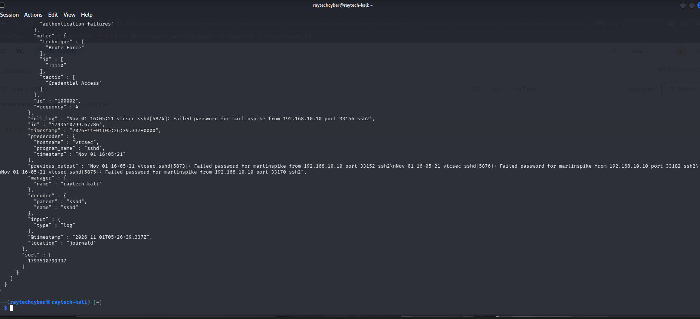

# SSH Brute-Force Detection with Wazuh — Mini SOC Lab

## Overview
This project simulates and detects an SSH brute-force attack in a small home SOC lab 
built with Wazuh (SIEM/XDR). It demonstrates the full detection lifecycle: running an 
attack, verifying default detection rules, identifying a gap in Wazuh's default 
correlation logic, and writing a custom detection rule to close that gap — mapped to 
the MITRE ATT&CK framework.

**Key finding:** Wazuh's default correlation rule for repeated SSH failures (rule 5720) 
did not trigger during a fast brute-force burst (6 attempts in 5 seconds). A custom 
rule was written and verified to correctly detect this pattern.

## Lab Environment
- **Attacker:** Kali Linux (also hosting the Wazuh Manager, Indexer, and Dashboard)
- **Target:** Ubuntu-based VM ("vtcsec"), monitored via Wazuh agent
- **Network:** VirtualBox internal network (192.168.10.0/24)
- **Tools:** Wazuh 4.14.7, Hydra, OpenSearch/Wazuh Dashboard

## Scenario: SSH Brute-Force Attack & Detection

### 1. Attack Execution
From the Kali attacker machine, a brute-force attack was launched against the SSH 
service on the target VM using Hydra with a small custom wordlist.

**Command:**
```bash
hydra -l marlinspike -P /tmp/passwords.txt ssh://192.168.10.15 -t 4 -V
```

**Result:** 6 login attempts were made in under 5 seconds. All failed (the correct 
password was deliberately not guessed), simulating a realistic failed brute-force 
attempt.


### 2. Default Detection
Wazuh's built-in rule **5760** ("sshd: authentication failed") correctly fired for 
each failed attempt, confirming basic detection was working as expected.


**Sample alert (from alerts.log):**

Rule: 5760 (level 5) -> ‘sshd: authentication failed.’
Src IP: 192.168.10.10
Src Port: 46562
User: marlinspike


### 3. The Gap: Default Correlation Rule Did Not Fire
Wazuh ships with a default correlation rule (**5720**) intended to catch multiple 
authentication failures from the same source. Despite 6 failed attempts in 5 seconds, 
well above what should trigger a brute-force correlation, **this rule never fired**.

Verified directly against the indexer:
```bash
curl -k -u admin:PASSWORD "https://localhost:9200/wazuh-alerts-*/_search?q=rule.id:5720&pretty"
# Result: 0 hits
```

This represents a real detection gap in the default ruleset for fast, low-volume 
brute-force attempts.

### 4. Closing the Gap: Custom Detection Rule

To address the gap left by rule 5720, a custom correlation rule was written and added 
to `/var/ossec/etc/rules/local_rules.xml`:

```xml
<rule id="100002" level="10" frequency="4" timeframe="60">
  <if_matched_sid>5760</if_matched_sid>
  <same_source_ip />
  <description>SSH brute force attempt: multiple authentication failures from the same source IP.</description>
  <mitre>
    <id>T1110</id>
  </mitre>
  <group>authentication_failures,pci_dss_10.2.4,pci_dss_10.2.5,</group>
</rule>
```

**Logic:** if rule 5760 (SSH authentication failure) fires 4 or more times from the 
same source IP within a 60-second window, raise a level 10 alert and tag it to 
**MITRE ATT&CK T1110 (Brute Force)**.

### 5. Verification
After restarting the Wazuh manager and re-running the Hydra attack, rule 100002 fired 
correctly, correlating 4 failed attempts and producing a single high-severity alert:




**Key fields from the alert:**
```json
"rule": {
  "id": "100002",
  "level": 10,
  "frequency": 4,
  "description": "SSH brute force attempt: multiple authentication failures from the same source IP.",
  "mitre": {
    "id": ["T1110"],
    "technique": ["Brute Force"],
    "tactic": ["Credential Access"]
  }
},
"data": {
  "srcip": "192.168.10.10",
  "dstuser": "marlinspike",
  "srcport": "33156"
}
```

This confirms the custom rule correctly identifies brute-force activity that the 
default ruleset missed.

## Troubleshooting & Lessons Learned

Building this lab surfaced several real operational issues, debugging them was as 
valuable a learning experience as the detection work itself.

### 1. Manager startup timeout
The Wazuh manager initially failed to start, timing out before all daemons came up. 
Root cause: the VM's limited resources meant startup took longer than systemd's 
default 90-second limit. 
**Fix:** added a systemd override increasing `TimeoutStartSec` to 900 seconds.

### 2. Alerts not appearing in the dashboard (Filebeat pipeline gap)
Alerts were confirmed firing correctly in `/var/ossec/logs/alerts/alerts.log`, but 
never appeared in the Wazuh dashboard or indexer. 

**Diagnosis process:**
- Confirmed Filebeat was running and could connect to the indexer (`filebeat test output` passed)
- Found repeated `"failed to publish events: temporary bulk send failure"` errors in Filebeat's logs
- Traced this to the indexer blocking all writes due to disk space

### 3. Disk space exhaustion
The VM's 68GB disk reached 99% usage, triggering OpenSearch's automatic read-only 
write-block safeguard. Investigation (`du -sh` across `/var`) revealed the cause: 
a 25GB PostgreSQL database belonging to GVM/OpenVAS (a separate vulnerability scanner 
pre-installed on Kali, unrelated to this project).

**Fix:** removed GVM entirely, freeing ~25GB, then cleared the indexer's write-block 
settings and restarted Filebeat. This immediately resolved the pipeline, and the 
custom rule 100002 alert appeared in the indexer as expected.

**Takeaway:** a SIEM's reliability depends on more than correct rule logic, disk 
space, resource limits, and pipeline health are just as critical, and are exactly 
the kind of operational issue a SOC analyst encounters in production.

## Conclusion & Next Steps

This project demonstrated a complete, small-scale detection engineering workflow: 
simulating an attack, validating default detection, identifying a real gap in the 
default ruleset, and closing that gap with a custom, MITRE-mapped correlation rule.

**Possible extensions:**
- Add Active Response to automatically block the attacking IP
- Extend detection to a second target (e.g., a web server) for a broader attack surface
- Add File Integrity Monitoring (FIM) as a second detection scenario
- Explore GVM/OpenVAS separately for a vulnerability-assessment companion project

## Author
**Raytechcyber** — Cybersecurity student, TS Academy
