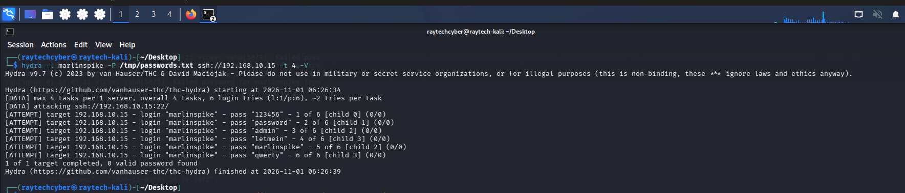
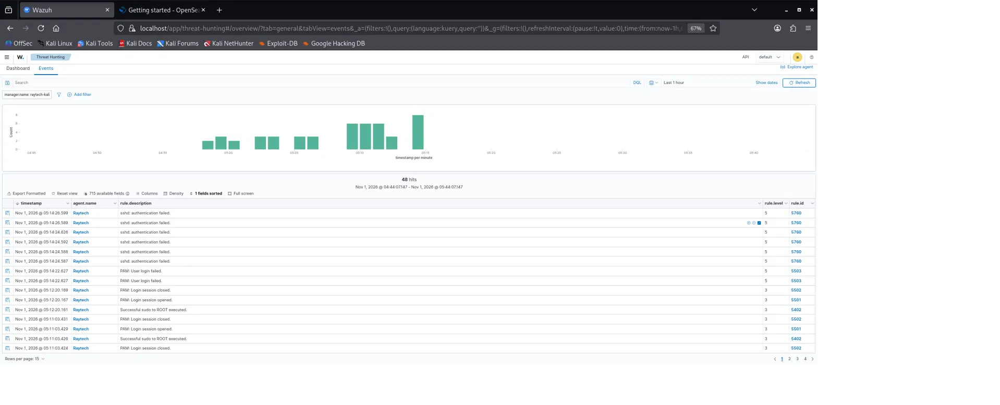

# SSH Brute-Force Detection with Wazuh — Mini SOC Lab

## Overview
This project simulates and detects an SSH brute-force attack in a small home SOC lab 
built with Wazuh (SIEM/XDR). It demonstrates the full detection lifecycle: running an 
attack, verifying default detection rules, identifying a gap in Wazuh's default 
correlation logic, and writing a custom detection rule to close that gap — mapped to 
the MITRE ATT&CK framework.

**Key finding:** Wazuh's default correlation rule for repeated SSH failures (rule 5720) 
did not trigger during a fast brute-force burst (6 attempts in 5 seconds). A custom 
rule was written and verified to correctly detect this pattern.

## Lab Environment
- **Attacker:** Kali Linux (also hosting the Wazuh Manager, Indexer, and Dashboard)
- **Target:** Ubuntu-based VM ("vtcsec"), monitored via Wazuh agent
- **Network:** VirtualBox internal network (192.168.10.0/24)
- **Tools:** Wazuh 4.14.7, Hydra, OpenSearch/Wazuh Dashboard

## Scenario: SSH Brute-Force Attack & Detection

### 1. Attack Execution
From the Kali attacker machine, a brute-force attack was launched against the SSH 
service on the target VM using Hydra with a small custom wordlist.

**Command:**
```bash
hydra -l marlinspike -P /tmp/passwords.txt ssh://192.168.10.15 -t 4 -V
```

**Result:** 6 login attempts were made in under 5 seconds. All failed (the correct 
password was deliberately not guessed), simulating a realistic failed brute-force 
attempt.



### 2. Default Detection
Wazuh's built-in rule **5760** ("sshd: authentication failed") correctly fired for 
each failed attempt, confirming basic detection was working as expected.



**Sample alert (from alerts.log):**

Rule: 5760 (level 5) -> ‘sshd: authentication failed.’
Src IP: 192.168.10.10
Src Port: 46562
User: marlinspike


### 3. The Gap: Default Correlation Rule Did Not Fire
Wazuh ships with a default correlation rule (**5720**) intended to catch multiple 
authentication failures from the same source. Despite 6 failed attempts in 5 seconds, 
well above what should trigger a brute-force correlation, **this rule never fired**.

Verified directly against the indexer:
```bash
curl -k -u admin:PASSWORD "https://localhost:9200/wazuh-alerts-*/_search?q=rule.id:5720&pretty"
# Result: 0 hits
```

This represents a real detection gap in the default ruleset for fast, low-volume 
brute-force attempts.
